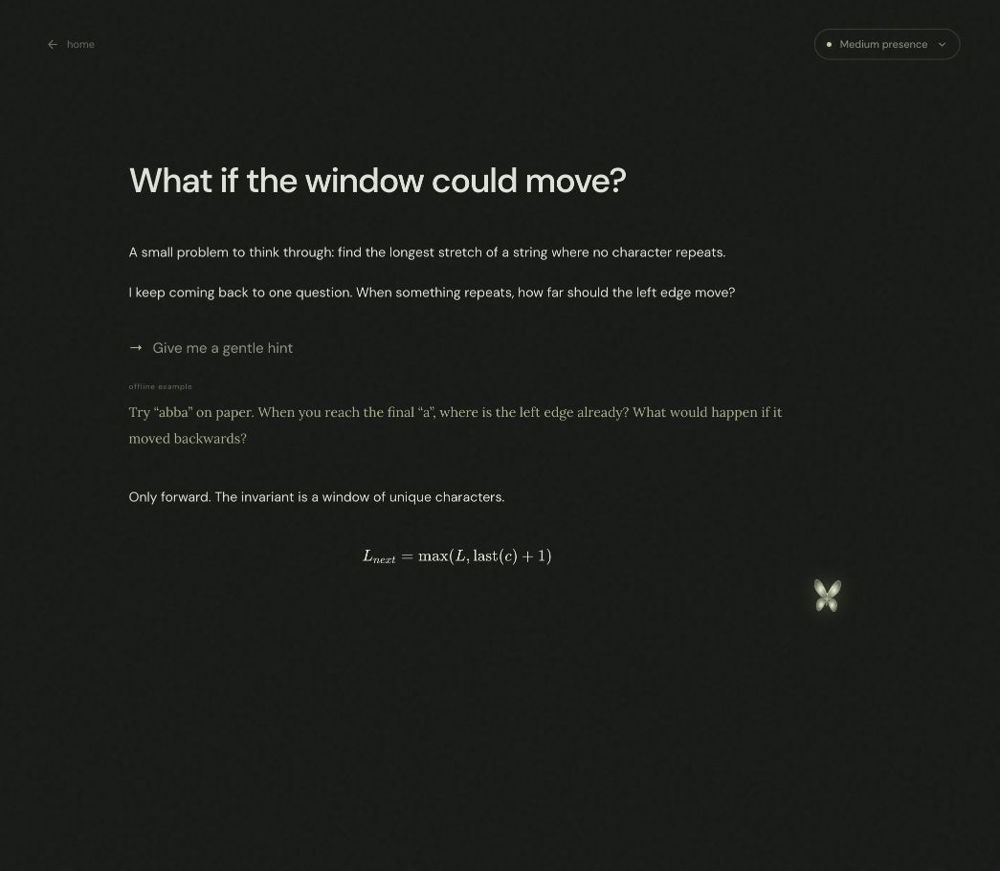

# Flutter

A quiet place to think, with a companion that thinks alongside you.

Flutter is a working, single-user notebook inspired by the Flutter Vision demo: a textured canvas, restrained typography, luminous butterfly, margin coaching, and in-document experiments. It includes warm light and dark themes.



<details>
<summary>Light home page</summary>


</details>

## Run locally

Requires **Node.js 24+** and **pnpm 11**.

```sh
pnpm install
cp .env.example .env
pnpm dev
```

Open **http://127.0.0.1:3000**. The notebook, equations, Python execution, diagrams, dice experiments, and built-in companion examples work without an AI key.

For live AI, set `AI_GATEWAY_API_KEY` in `.env`, then restart the server. Keys stay on the server. No key entry is required in the browser.

```dotenv
AI_GATEWAY_API_KEY=your_key_here
FLUTTER_GATE_MODEL=anthropic/claude-haiku-5.5
FLUTTER_REASON_MODEL=anthropic/claude-sonnet-5.5
```

Models were selected from the AI Gateway catalog when this project was created. Both identifiers are configurable. An unavailable provider/model is shown as an error; the app does not silently pass off examples as live reasoning.

```sh
pnpm test
pnpm build
NODE_ENV=production pnpm start
```

## What you can do

- Write rich text with headings, lists, quotes, inline code, and undo/redo.
- Type `/ your thought` on its own line and press **Enter** to talk directly to the companion. The question and response stay in your note; there is no separate chat panel.
- Press **⌘K / Ctrl+K** or click the butterfly to begin a `/` thought in the editor. **Shift+Enter** adds a line without submitting.
- The home page holds the companion introduction, document library, theme, and export controls. Inside every document, a small butterfly follows your writing and brings optional margin thoughts. Presence is the only preference available while writing.
- Type `/code`, `/math` (optionally followed by LaTeX), `/diagram`, or `/dice` and press **Enter** to insert a block.
- Insert and edit LaTeX equations; inline `$…$` input rules are supported.
- Edit Python in CodeMirror and run it locally using Pyodide/WebAssembly.
- Insert diagrams and a real 100-dice simulation.
- Accept or dismiss inline companion proposals. Accepted content is inserted after the exchange, preserving anything you have written since asking, and is undoable. Exchanges persist with the document. Interrupted requests can be retried inline.
- Choose **light, medium, or high presence**, or pause ambient observation entirely.
- Switch between light and dark canvases. Theme, intervention level, and pause preference persist.
- Create, rename, and search notes. Export a complete note as JSON.
- Keep writing while the server is unavailable; document state is stored in IndexedDB.

## How the companion works

1. Editor transactions update the local Yjs document immediately.
2. Yjs state is persisted in IndexedDB and batched to the local server after 700 ms. Periodic reconciliation runs while the page is visible.
3. A client policy checks meaningful changes, idle time, cooldowns, and whether the user has paused observation.
4. For ambient opportunities, a small Haiku call decides whether to remain silent.
5. Only useful opportunities go to Sonnet. Explicit questions skip the gate.
6. Typed output is schema-validated. No model-generated HTML is rendered.
7. Ambient results are checked against a fingerprint of the note, including code/math, and discarded when stale. Direct replies attach to their original exchange by stable ID; accepting a proposal inserts after that exchange without replacing subsequent writing.

| Presence | Pause before evaluation | Minimum cooldown | Minimum change |
| -------- | ----------------------: | ---------------: | -------------: |
| Light    |              12 seconds |      120 seconds | 100 characters |
| Medium   |             6.5 seconds |       60 seconds |  45 characters |
| High     |             3.5 seconds |       25 seconds |  20 characters |

The server also enforces ambient cooldowns, request limits, a 45-second deadline, and cancellation of superseded calls. UI progress stages stream as NDJSON; answer content arrives after the complete structured response validates. Raw keystrokes are not logged or sent to the model.

**Offline mode is deliberately labeled.** It offers built-in hints for the sample, a diagram, and a Python example. It is not an on-device language model and does not pretend to answer arbitrary questions.

## Architecture

```text
React + Tiptap ── Yjs ── IndexedDB
       │            └── batched HTTP sync ── atomic files in .data/notes
       │
       ├── activity policy ── Haiku gate ── Sonnet reasoning
       │                                      │
       └── margin / inline exchanges ← validated proposals

Python cell ── opaque-origin iframe ── Web Worker ── Pyodide
```

- `src/components/NoteEditor.tsx`: document lifecycle, collaboration binding, persistence.
- `src/components/Blocks.tsx`: code, diagram, and dice node views.
- `src/components/AgentTurn.tsx`: persisted inline conversations and anchored proposals.
- `src/components/Home.tsx`: document library and notebook preferences.
- `src/lib/policy.ts`: intervention rules and content fingerprints.
- `src/lib/context.ts`: structured-note context extraction.
- `server/companion.ts`: staged model calls and honest offline behavior.
- `server/store.ts`: serialized, atomic Yjs snapshot merges.
- `agent/`: versioned companion instructions and an eve agent definition. The notebook currently calls the AI SDK through its own bounded HTTP adapter; durable eve session routing is not wired into the browser yet.
- `public/runner.html`: isolated Python execution bridge.

## Persistence and execution boundaries

This release is a **personal local app**, not a hosted multi-user service. The server intentionally accepts only loopback hosts. Authentication, workspace membership, encrypted cloud storage, cross-device account sync, and deployment are not included. Add those before exposing it publicly. The local `.data/` directory and `.env` are ignored by Git.

Yjs changes merge on the server; transport currently sends batched snapshots rather than incremental WebSocket updates. This keeps the first release straightforward. Large notebooks should move to incremental updates and compaction. Titles are last-write-wins metadata. Collaboration across authenticated users is not implemented.

Python runs only when the user clicks Run, inside an opaque-origin sandboxed iframe and a disposable Web Worker. The iframe cannot access the app DOM or storage, and the API rejects its `Origin: null` requests. CSP restricts network access to locally served runtime assets. Startup has a 45-second timeout; execution has an 8-second timeout and 16 KB output limit. Browser workers do not provide hard process-memory quotas: use a server sandbox with memory limits before supporting hostile shared code. Python variables are fresh on each run; third-party package installation is not supported.

Diagrams are intentionally limited to a sequence of typed labels. Generated arbitrary interactive JavaScript, web research/citations, multi-agent coordination, and long-term AI memory are not included. Only bounded current-note context and the most recent four completed inline exchanges are sent to AI. Google Fonts is the only remote dependency used by the canvas; system fallbacks remain available.

## Verification

Automated tests cover intervention policy, silent/offline behavior, schema validation, concurrent Yjs merges, persistence across store re-open, HTTP save/reload, cross-origin rejection, NDJSON responses, inclusion of code/math in stale-response detection, slash routing, and completed-exchange context.

Browser QA covers dark/light modes, home-only preferences, presence controls, pause/resume, inline questions and reload persistence, writing while a proposal is pending, anchored acceptance, math/code insertion, undo, Python execution, and a 100-dice run. Live paid-model responses require your API key and are not asserted by these offline tests.
